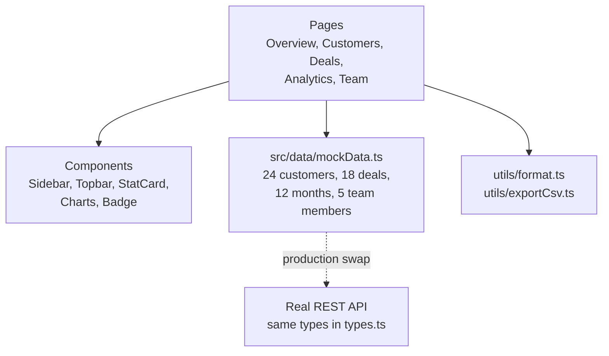

# PulseBoard — SaaS Analytics & CRM Admin Dashboard


**PulseBoard** is a production-style admin dashboard for a B2B SaaS: revenue and growth analytics, a full CRM customer table, a sales pipeline, and team role management — in one dark, responsive app that runs with zero backend setup.

Built as Portfolio Project 3 of 6 (after ServeNow, the Flutter booking app). It plays to the same stack as a real client dashboard: React + TypeScript, typed data models, and every number computed from data — never hard-coded into a screenshot.

> **Demo in 30 seconds:** `npm install && npm run dev` → Overview shows MRR, pipeline and win rate → Customers → search "Ayesha", filter by Plan, sort by MRR, Export CSV → Deals → filter by stage → Team → change a role, invite a member.

---

## ✨ Features

| Area | What it does |
|---|---|
| **Overview** | MRR, active customers, open pipeline, win rate — all computed from data; revenue trend (SVG line), acquisition donut, top accounts, latest deals |
| **Customers (CRM)** | 24 realistic accounts, live search, status + plan filters, click-to-sort, pagination, health scores, **CSV export** |
| **Deals & Pipeline** | Open / weighted pipeline, won / lost totals, stage filter chips, probability bars, CSV export |
| **Analytics** | Revenue vs expenses, monthly profit table (profit is computed), growth insights derived from the same data |
| **Team & Roles** | Change roles in place (Admin / Manager / Agent), invite members, and a plain-words permission table per role |
| **Theme** | Dark-first design with a light-mode toggle; responsive down to mobile (sidebar collapses) |

## 🧭 Pages (demo order for screenshots)

1. **Overview** — the four founder numbers + revenue line + channels donut
2. **Customers** — search, filter, sort, export (the page clients screenshot first)
3. **Deals** — pipeline cards + stage filter
4. **Analytics** — monthly breakdown + "what the numbers say"
5. **Team & Roles** — role dropdowns + invite form + permissions

## 🏛️ Architecture

Pages never hard-code a number. They read typed mock data, compute totals in the component, and render through shared components. Swap the data file for API calls and the UI stays untouched.



## 📁 Folder structure

```text
pulseboard/
├── package.json / vite.config.ts / tsconfig.json
├── index.html
├── README.md
└── src/
    ├── main.tsx / App.tsx          # Page routing (state-based) + theme + team state
    ├── index.css                   # Design system (dark-first, light override)
    ├── data/
    │   ├── types.ts                # Customer, Deal, TeamMember, MonthPoint…
    │   └── mockData.ts             # Seed data — totals agree across pages
    ├── utils/
    │   ├── format.ts               # USD / date formatting, one place
    │   └── exportCsv.ts            # Browser CSV export, no server needed
    ├── components/
    │   ├── Sidebar.tsx / Topbar.tsx
    │   ├── StatCard.tsx / Badge.tsx
    │   └── Charts.tsx              # Hand-rolled SVG line, bar & donut charts
    └── pages/
        ├── Overview.tsx / Customers.tsx / Deals.tsx
        └── Analytics.tsx / Team.tsx
```

## 🎨 UI/UX polish guide

**Palette**

| Token | Hex | Use |
|---|---|---|
| Primary indigo | `#6366F1` | Buttons, active nav, charts |
| Success emerald | `#10B981` | Growth, Active, Won |
| Amber | `#F59E0B` | Trial, attention, health 50–70 |
| Rose | `#F43F5E` | Churned, Lost, health < 50 |
| Dark bg / card | `#0B1220` / `#111C33` | Dark scaffold / cards |
| Light bg / card | `#F1F5F9` / `#FFFFFF` | Light mode |

**Typography:** system Inter stack (no font download, works offline). Headings 800–900 weight, muted secondary text at 13px.

**Layout rules used throughout**

- One card, one job: a stat, a chart, or a table — never two.
- Colour is meaning: green = good, amber = needs attention, red = at risk.
- Tables always have a filter, a sort, and an export — a table without export is a dead end for an admin user.
- Numbers are computed, not typed: change `mockData.ts` and every page, chart and insight updates.

## 🚀 Installation & run

```bash
npm install
npm run dev      # http://localhost:5173
npm run build    # tsc --noEmit + vite build (must pass clean)
```

**No keys, no backend, no database.** All data is local in `src/data/mockData.ts`.

## 💼 Business value — why a client hires from this

- **Internal tools are a constant freelance brief:** startups need exactly this — customers, pipeline, revenue, roles — and most portfolios only show landing pages.
- **A working table beats a pretty mockup:** search, filter, sort, paginate and CSV export are the features an operations manager actually uses daily, and they work here on real (seed) data.
- **Numbers that agree:** MRR, monthly revenue and the customer table all come from the same dataset, so a client checking the maths finds no contradictions.
- **Roles are stated, not implied:** the permission table answers the client's first security question before they ask it.

## 🗺️ Roadmap to production (for a real client)

1. Replace `mockData.ts` reads with `fetch` calls to the client's API (types in `types.ts` already match).
2. Persist team-role changes to the backend and enforce them in the API, not just in the UI.
3. Add auth (role from the session, not a dropdown) and audit logging for role changes.
4. Add a real chart library (Recharts) only if the client needs tooltips/zoom — the SVG charts cover the demo.
5. Connect Stripe / billing data for real MRR instead of seed MRR.

## 📸 Suggested screenshots (for GitHub / Fiverr / LinkedIn)

Overview (dark) → Customers with a search + filter applied → Deals pipeline → Analytics monthly table → Team roles. Capture dark mode first, then one light-mode shot to prove the theme toggle.

---

*Built as Portfolio Project 3 of 6 — Flutter, Web, and ML showcases. ServeNow (Project 2) is at [uzaairmalik/servenow](https://github.com/uzaairmalik/servenow).*
